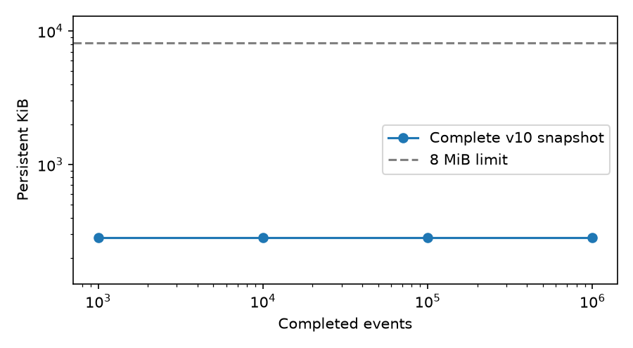

# v10 판정 · 고정 용량에서의 경험 통합

**전체 사전 기준 실패.** 단발 예외가 남고 파일 크기가 고정됐지만, 객체 합침 정밀도, 3D 전이 예측, 방향 변경 후 귀환, 새 목표 계획은 기준 미달이다. [최초 등록](V10_PROTOCOL.md) · [구현 가설](V10_THEORY.md)

## 백만 사건

10101 단일 스트림, 1천 건씩 입력 후 버리는 방식. 1K, 10K, 100K, 1M마다 저장하고 파일에서 다시 읽어 계속 학습했다. 매번 전체 289,100 B. 교체 중 이전 파일까지 578,200 B. 벡터 저장소, SQLite, 외부 사건 로그 없음. 원래 사건을 폐기한 후 12가지 반복 조건과 중간의 관측 가능한 체제 변화, 1회 큰 오차를 평가했다. 체제는 첫 감각 성분이 함께 달라지는 설정이다. 보이지 않는 체제를 식별했다는 증거는 없다.



| 1M 뒤 MSE | v10 | FIFO | 균일 reservoir |
|---|---:|---:|---:|
| 초반 단발 사건 | 0 | .68690 | .68676 |
| 이전 체제 법칙 | 1.00e-7 | .01931 | 2.33e-5 |
| 새 체제 법칙 | 9.71e-8 | 2.51e-5 | 2.22e-5 |
| 초반 평범한 사건 | .0000257 | .01467 | .0000803 |

평범한 사건의 개별 잡음은 사라지고 평균적 결과가 남았다. 서로 다른 모드에 25개 원형이 쓰였다. 가까운 새 가짜 단서 하나에서 예외 오인출은 없었다. FIFO와 reservoir는 같은 바이트 예산에서 각각 84, 92 B짜리 사건을 담는다. 단일 스트림 결과에 유의성 검정을 적용하지 않았다. [체크포인트와 엔티티 진단](measurements/v10_stream.json)

## 동일성 및 공유 효과

12개 새 씨앗. 위치 이동·평면 회전·노출·부분 가림을 사용했고, 다른 몸의 카메라는 가림 조건으로 단순화했다. 외형이 같은 쌍을 포함한다. 각 객체를 알고 있는 것은 평가자뿐이다. 모델은 이전 동작과 실제 센서 변화의 곱을 받는다. 모든 조회와 학습 인스턴스 쌍으로 평가했을 때 정밀도 .620, 재현율 .979, 잘못 합침 .043, 잘못 나눔 .021. 행동 이력을 제거하면 각각 .269, .927, .183, .073이었다. 정밀도 .8 기준에 실패했다. 숨은 물체의 진짜 3D 회전과 실제 기기 간 대응은 미검증이다.

새 외형을 무작위 감각 벡터로 바꾸고 이미 학습한 반응 법칙을 공유하게 한 시험에서 효과 MSE는 .0000182, 사건 최근접 .000938, 개체 원형만 .001006, 직전값 .01991. 매핑한 효과 목표는 관측한 probe 반응의 별도 비선형 함수다. 이 조건은 보지 못한 종류의 법칙을 발명하는 시험보다 쉽다.

## 비선형 지연 동역학

12개 씨앗. 실제 이전 명령이 다음 효과에 영향을 미치며 모든 모형이 같은 명령 흔적을 본다. 자체 예측을 8회 되먹였다.

| 모델 | 1걸음 MSE | 8걸음 MSE |
|---|---:|---:|
| v10 | .00723 | .04345 |
| v9 전이 | .00691 | .02265 |
| RLS | .00666 | .01394 |
| FIFO / reservoir (각 512건) | .00572 / .00595 | .02205 / .02194 |
| VQ / 개체 원형만 | .00669 / .00712 | .03163 / .03230 |
| 직전 상태 유지 | .01133 | .07743 |

직전값보다 좋고 사건 기준보다 나빴다. 공유 법칙을 제거한 개체 원형이 오히려 우세했다. 이 실험의 비교군은 같은 사건 수에서 학습했으며 각 모델의 저장 바이트가 같지는 않다. [1·4·8걸음 및 제거 실험 원자료](measurements/v10_dynamics.json)

## 새로운 3D 미로 24개

판정기는 다른 미로의 600개 독립 한 걸음에서 배운 뒤 새 미로의 다음 시야를 검사한다. 평균 MSE .02625, 직전값 .02287로 전이 실패. 현지 구조를 학습하는 다음 단계는 각 방에서 무작위 위치·방향에 놓는 **1,000번의 개별 한 걸음**과 한 번의 연속 출발 여정을 제공한다. 이 배치는 판정기만 알며 개체 입력은 감각과 실행 명령이다. 이 비교는 현지 탐색을 자발적으로 해내는 능력을 측정하지 않는다. v9 경로 대조군은 자체 프로토콜의 별도 미로 96걸음과 출발 여정을 받으므로 동일한 자료량 비교가 아니다.

| 개입 | 출발 자세 식별 /24 | 원점 귀환 /24 |
|---|---:|---:|
| 그대로 | 21 | 2 |
| +90° | 19 | 2 |
| −90° | 18 | 2 |
| 180° | 24 | 3 |
| 한 칸 이동 | 24 | 2 |
| 초기 시야 일부 가림 | 17 | 2 |

v9의 실제 경로 역재생은 그대로 24/24, 180° 0/24. v10은 경험한 길의 출발점으로 계획한 결과다. 새 목표는 연속 여정에 포함되지 않은 두 장소로 최소 두 번 이동해야 한다. 성공 7/24, 무작위 3/24, 시간 연결 제거 0/24. 등록한 12/24 미달. 관측과 맞는 시작 자세를 골라도 전이 원형을 따라 끝까지 이동하는 성능은 낮았다. [미로별 기록](measurements/v10_world.json)

## 어떤 구성요소가 기여했나

64개 조건이 48개 원형을 넘는 추가 스트림에서 병합을 끄면 평범한 조건의 MSE가 .0000245에서 .0000365로 증가했다. 놀람 선별을 끄면 예외 원형 사용량이 1개에서 16개가 됐지만 이 실험의 단발 회상은 같았다. 예외를 꺼도 단발 사건은 개체 원형에 남았다. 백만 사건의 단발 성공을 예외 슬롯만의 공으로 돌릴 수 없다. 추가 등록한 고간섭 시험에서 실제 인출의 예측 이득으로 무게를 보정하니 평범한 사건 MSE는 .02390에서 .02044로 감소했으나 단발 MSE는 .05230에서 .05981로 악화했다. 해당 정책은 선택 사항이다. [제거 실험](measurements/v10_ablation.json) · [후속 가설](V10_REGRET_PROTOCOL.md) · [후속 측정](measurements/v10_regret.json)

## 재현

저장소 루트에서 pip install -e ".[research-v10]" 후 python -B -m research.v10_stream, research.v10_dynamics, research.v10_world, research.v10_diagnostics, research.v10_regret 각각을 모듈로 실행한다. diagnostics는 stream 결과를 읽어 그래프도 만든다. 전체 테스트는 python -B -m unittest discover -q. 데스크톱에서 실행했고 실제 안경의 전력과 실행 시간은 측정하지 않았다.

```python
from loki_memory.lifelong import LifelongMemory

memory = LifelongMemory()
memory.learn(keys, commands, observed_effects)  # (N,12), (N,), (N,8)
forecast = memory.predict(query, command)
memory.save("life.bin")
memory = LifelongMemory.load("life.bin")
```
