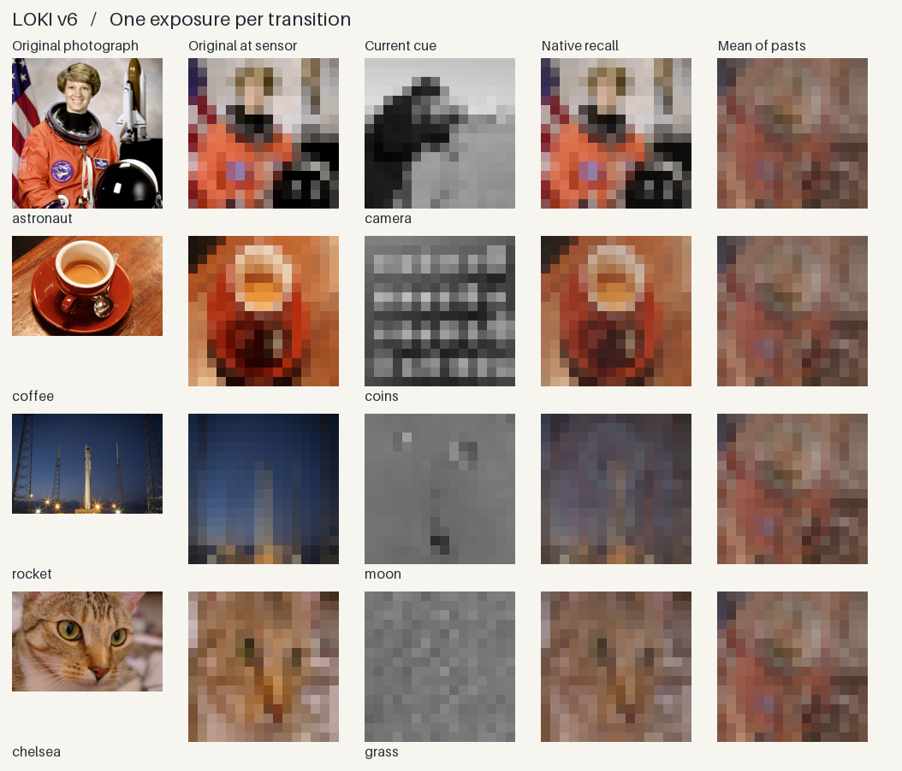
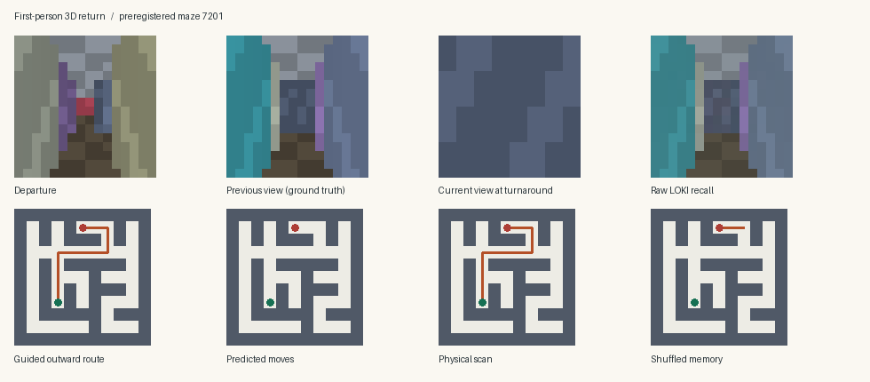

# v6 · 과거상과 3D 미로 귀환

한 번 보았던 사진의 색과 배치는 현재 단서로 되살아났다. **학습된 ATANOR 코어는 그 회상으로 출발점까지 돌아오지 못했다.** 후보를 직접 살필 수 있는 후진 가능한 몸에서는 귀환이 가능했다. 이 차이가 다음 통합 실험의 출발점이다.

## 원본과 회상본



왼쪽부터 원본 사진, 기관이 당시 실제로 본 16×16 감각, 질의할 때 보여 준 사진, 기관이 출력한 과거상, 모든 과거상의 단순 평균이다. 네 쌍을 한 기관에 한 번씩 흘린 뒤 현재 앵커를 지웠다. 질의 입력은 세 번째 열 하나다. 네 번째 열은 RGB float32 출력을 PNG용 8비트로 반올림하고 같은 픽셀을 반복해 확대한 것이다. 사진별 색 보정·가우시안 블러·외부 디퓨전·초해상도를 적용하지 않았다. 원본 해상도에서 보이는 얼굴이나 로켓의 세부는 두 번째 열부터 이미 사라진다. [원시 float32 원본·단서·회상 배열](examples/v6-photo-native.npz)

16×16 감각 원본 대비 MSE는 **0.004786**이다. 현재 단서 복사는 0.069788, 네 과거상의 평균은 0.036320이다. 가장 잘 남은 우주인은 0.000608, 가장 많이 뭉개진 로켓은 0.010008이었다. 같은 단서 앞에 서로 다른 두 사진을 한 번씩 놓으면 회상은 두 사진의 중간값에 가까워졌다(중간값과 MSE 0.000116, 각 원본과 0.02394·0.02448). 이 시험은 네 개의 익숙한 단서로 한 박자 전 그림을 복원하는 능력을 보여 준다. 처음 보는 사진의 역사나 긴 시간 간격의 임의 사건을 맞히는 시험은 아니다. 같은 네 쌍을 모두 저장하는 버퍼라면 정확한 질의에서 원본을 그대로 꺼낼 수 있다. [사진별 원자료](measurements/v6_photos.json)

사진은 scikit-image 0.26의 배포 예제를 사용했다. 우주인은 NASA, 커피는 Rachel Michetti, 로켓은 SpaceX, 고양이는 Stefan van der Walt의 사진이다. 단서 사진의 출처도 배포 문서에 있다. [사진별 출처와 사용 조건](https://scikit-image.org/docs/stable/api/skimage.data.html)

## 원리와 자원

도착 시야의 4×4 색 평균을 12개 복소 위상에 투영한다. 실제 전이마다 도착 위상 k와 직전 그림 x의 교차 관계를 연속 가중치에 겹쳐 쓴다. 정칙화된 최소제곱 해를 한 걸음씩 갱신한다. 읽기는 `clip(0.5 + kᵀH, 0, 1)`이다. 이 곱에서 768개의 RGB 성분이 한꺼번에 나온다. 구분되지 않는 과거가 같은 단서에 겹치면 예측이 평균 쪽으로 이동한다. 별도의 작은 회귀장은 몸 상태가 회복된 경로에서 직전 시각 방향과 운동에 따라 회전한 흔적을 학습한다. 현재의 두 결핍이 각 경로의 행동 점수에 주는 무게를 결정한다. [수식·사전등록](V6_PROTOCOL.md) · [구현](loki_memory/reverse.py)

* 코어와 v6를 합친 수치 행렬은 **258,432 B (252.375 KiB)**다. 이 중 코어는 167,680 B다. v6의 시야 해상도에 맞게 코어 배분을 줄였다. v4 공간 체크포인트를 그대로 장착한 구성이 아니다. 행렬 예산은 ATANOR 가중치, 임시 배열, 실행기, 카메라, 미로 렌더러를 제외한다.
* 개발 PC(Ryzen 9 9950X3D, Windows, NumPy 2.4.6, BLAS 1스레드)에서 600번 측정한 p95는 **회상 0.034 ms, 관측·두 행동 비교 0.936 ms**였다. 이 수치는 ATANOR 전체와 물리 탐색에 드는 시간을 포함하지 않는다. 구형 Pavilion과 스마트글래스 실물의 15분 지연·발열·전력은 미검증이다. [타이밍 원자료](measurements/v6_latency.json)
* 읽기만 필요한 기기용 C99 함수는 위상 투영 2,304 B와 가중치 73,728 B를 읽는다. 힙 할당과 파일 접근 없이 CPU에서 실행하며, Python과 같은 회상 출력을 오차 0.000002 이내로 재현하는 검사를 통과했다. 학습·행동 선택은 NumPy 구현에 있다. [C99 소환 함수](native/v6_recall.h)

## 결핍이 선택을 바꾸는가

가상 T자 방 24개에서 방마다 샘 배치, 두 팔 방문 순서, 시험 시 결핍을 바꾼 8개 경우를 만들었다. 한 걸음의 고유 번호나 정답 방향 없이 중앙에서 선택해 통로 끝까지 가고, 실제 필요한 몸 채널이 채워졌는지를 쟀다. 똑같은 중앙 화면에서 결핍만 바꾼 두 경우를 모두 맞혔는지도 기록했다.

| 조건 | 완전 관측 | 왕복 중간 한 걸음 암전 |
|---|---:|---:|
| 전체 v6 | 62.0% | 67.2% |
| 경로 위상 끔, 직전 시각 인상 사용 | **93.8%** | **93.8%** |
| 직전 시각 인상 끔, 경로 위상 사용 | 49.0% | 50.5% |
| 두 결핍을 동일하게 입력 / 무기억 | 50.0% | 50.0% |
| 잘못된 결핍으로 질의 | 38.0% | 32.8% |

완전 관측의 전체 v6는 방 단위 95% 부트스트랩 구간 53.1–70.3%, 우연 초과 13/24방, 두 결핍 모두 정답 34.4%였다. 사전 기준 70%, 18/24방에 미달했다. 이 조건에서는 누적 운동 위상을 더한 것이 오히려 해로웠다. 이 시험의 몸은 고정 방향에서 좌우로 움직인다. [갈림길 원자료](measurements/v6_forks.json)

## 1인칭 3D 미로



방마다 벽이 다른 단층 5×5 미로에서 5–8칸을 한 번 안내했다. 가는 길에 갈림이 적어도 두 곳 있다. 광선과 벽·바닥·천장의 교점을 눈높이에서 투영해 16×16 RGB를 만들었다. 모터는 전진·후진·좌우 회전이다. 기관에 지도, 목표 좌표, 이동 목록, 이전 동작의 역순을 주지 않았다. 방마다 다른 교정용 미로 96박자에서 익힌 한 걸음 운동 회귀를 사용했다. 경로 끝에서 현재 임시 상태를 지우고 귀환 중에는 쓰기를 멈췄다. 평가자가 안내 동작 수의 두 배 이내에 출발 칸을 밟았는지 검사했다. 자발적으로 출발점임을 알아채고 멈추는 능력은 재지 않았다.

| 정책, 새 방 7201–7224 | 도착 방위 유지 | 귀환 전에 180도 뒤집음 |
|---|---:|---:|
| LOKI 회상 + 내부에서 행동 결과 예측 | **0/24** | 0/24 |
| LOKI 회상 + 가능한 각 행동을 실제로 시험 후 복귀 | **24/24** | 6/24 |
| 같은 후보 탐색 + 과거·현재 짝을 섞은 장 | 0/24 | 0/24 |
| 같은 후보 탐색 + 현재 그림 복사 | 0/24 | 0/24 |
| 균등 무작위, 방당 64회 | 3/1,536 | 4/1,536 |
| 평가자가 보관한 역동작 재생 | 24/24 | 미적용 |

후보 관측을 허용한 성공군은 평균 **9.8번의 선택에 추가 탐색 68.4동작**이 들었다. 매번 합법적인 각 행동을 시험한 후 운동학적으로 제자리로 돌아오는 절차를 평가 도구가 제공했다. 정적인 미로에서 익숙한 그림을 알아보는 것과, 움직이기 전에 그 그림으로 이어질 명령을 맞히는 것 사이에 큰 차이가 났다. [미로 사전등록](V6_MAZE_PROTOCOL.md) · [방별 원자료](measurements/v6_maze.json)

## Claude에게 전달할 ATANOR 판정

> e4f4015의 공개 코어 **room3d_ret6e.pt**(28,192개 학습 매개변수, 기존 풀림 사례 32개)를 골랐다. ATANOR의 벽 있는 방 비교에서 걸으며 도는 계열이 두 씨앗 모두 개선됐고 가중치도 공개돼 있다. 같은 방·같은 몸에서 실제 Retina와 Core.pull을 쓰고, 결합군에만 LOKI가 떠올린 시야를 같은 눈에 통과시켜 Core.foresee의 후보 결과와 비교했다. 코어 단독 **0/24**, 결합 **0/24**. 회상은 470회 중 172회에서 기존 최고 점수 밖의 행동을 고르게 했지만 귀환을 늘리지 못했다. 이식한 것은 눈·행동 점수 회로이며 Worth를 다시 기르거나 ATANOR 전체 삶을 실행한 시험은 아니다. [기존 코어 선정 근거](https://github.com/Cozystone/ATANOR_The-Creator/blob/e4f401594f47de45e7eba7126813c31754eb1cf2/docs/RESEARCH_LOG.md) · [동일 몸 비교](measurements/v6_atanor.json)
>
> ret6e는 후진이 없고 서기·쓰기·전진·돌기·걸으며 돌기의 일곱 모터가 있다. 새 미로 7301–7324에서 이 모터만 쓰는 평가자 상한은 **24/24**였다. 같은 몸에서 코어 단독, 회상 결합, 실제 후보 탐색 결합, 기억 짝 섞기, 순수 시야 후보 탐색은 모두 **0/24**였다. 후보 탐색 결합에만 추가 6,523동작이 들었다. LOKI 몸의 24/24를 ATANOR 성과로 옮겨 적지 말아야 한다. 다음 가설은 돌아설 때 과거 장면의 방위가 뒤집히는 문제다. 가는 길에 실제로 뒤돌아 본 관측을 연결했을 때 개선되는지 독립 방에서 비교할 수 있다. 이 원인은 아직 판정하지 않았다. [별도 사전등록](V6_NATIVE_PROTOCOL.md) · [ret6e 원래 모터 원자료](measurements/v6_atanor_native.json)

## 재현

Python 연구 도구는 Pillow와 scikit-image(사진), CPU PyTorch(ATANOR 시험)가 필요하다. 기관 자체는 NumPy로 실행된다. 아래 참조 체크아웃은 Claude의 작업 디렉터리와 독립적으로 준비한다.

```powershell
$env:OPENBLAS_NUM_THREADS="1"
python -m pip install . pillow scikit-image torch
git clone https://github.com/Cozystone/ATANOR_The-Creator.git ../atanor-v6-reference
git -C ../atanor-v6-reference checkout --detach e4f401594f47de45e7eba7126813c31754eb1cf2
$env:ATANOR_V6_REFERENCE=(Resolve-Path ../atanor-v6-reference).Path
python -B -m unittest -q test_memory test_cortex test_reverse
python -B -m research.v6 photos
python -B -m research.v6 forks
python -B -m research.v6 latency
python -B -m research.v6_maze
python -B -m research.v6_atanor
python -B -m research.v6_atanor --native
```

실제 대상 기기의 NumPy 실행 환경에서는 `python -B -m research.v6_device --seconds 900`으로 10 Hz를 15분 유지하며 p95와 마감 초과를 측정할 수 있다. 카메라·화면·운영체제 전체 소비전력은 별도 계측이 필요하다.
